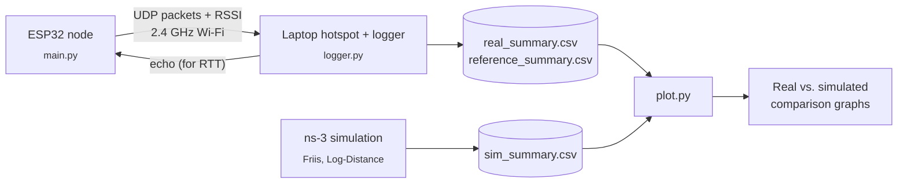

# ESP32 Wi-Fi Attenuation Study

**Real-World vs. Simulated Wi-Fi Signal Attenuation for a Low-Power IoT Node in an Indoor Campus Environment Using an ESP32 Microcontroller**

A low-cost testbed that measures how indoor Wi-Fi signals weaken over distance and through walls, using a single ESP32 as the measurement node, and compares the results against ns-3 propagation models.

> Network Simulation Study (NSS) project for NSCOM03 Data Communications, De La Salle University.

---

## Table of Contents

- [How It Works](#how-it-works)
- [Repository Structure](#repository-structure)
- [Requirements](#requirements)
- [Setup](#setup)
- [Running a Test](#running-a-test)
- [Data Format](#data-format)
- [Plotting Results](#plotting-results)
- [Research Objectives](#research-objectives)
- [Troubleshooting](#troubleshooting)
- [Team](#team)

---

## How It Works



1. The **ESP32** joins the laptop's hotspot and sends a numbered UDP packet every 100 ms, carrying its current signal strength (RSSI).
2. The **laptop logger** receives each packet, echoes it back so the ESP32 can measure round-trip time, and records everything. Missing sequence numbers = packet loss.
3. The laptop also reads the ESP32's signal **from its own side** (`iw station dump`), giving a second, independent RSSI reading as a reference.
4. **ns-3** simulates the same distances and obstacles using the Friis and Log-Distance propagation models.
5. **`plot.py`** combines everything into comparison graphs.

## Repository Structure

```
.
├── main.py          # ESP32 firmware (MicroPython): sends packets + RSSI
├── logger.py        # Laptop logger: receives packets, measures loss, RTT, reference RSSI
├── plot.py          # Builds comparison graphs from every *_summary.csv in data/
├── so3_test.py      # Phase 2: direct vs. ESP32-repeater test (iperf3)
├── ns3/             # ns-3 simulation scripts
└── data/            # Measurement and simulation CSVs
```

## Requirements

**Hardware**

- ESP32 dev board (ESP32-WROOM-32)
- USB data cable
- Linux laptop with a Wi-Fi card that supports AP mode
- Power bank (to run the ESP32 away from the laptop)

**Software**

- [MicroPython](https://micropython.org/download/ESP32_GENERIC/) firmware for ESP32
- Python 3 with `pandas` and `matplotlib`
- [`esptool`](https://github.com/espressif/esptool) and [`mpremote`](https://docs.micropython.org/en/latest/reference/mpremote.html)
- `iw`, `nmcli`, `firewalld` (preinstalled on Fedora)
- [ns-3](https://www.nsnam.org/) for the simulation

```bash
pip install --user esptool mpremote pandas matplotlib
```

## Setup

### 1. Flash MicroPython to the ESP32

```bash
esptool --port /dev/ttyUSB0 erase-flash
esptool --port /dev/ttyUSB0 --baud 460800 write-flash 0x1000 ESP32_GENERIC-20260824-v1.29.0.bin
```

> [!TIP]
> If it hangs on `Connecting...`, hold the **BOOT** button on the board until writing starts.

### 2. Upload the node code

```bash
mpremote connect /dev/ttyUSB0 cp main.py :main.py
mpremote connect /dev/ttyUSB0 reset
```

The ESP32 now runs `main.py` automatically every time it powers on.

### 3. Configuration

Default values in `main.py` and `logger.py`:

| Setting | Value |
| --- | --- |
| Hotspot SSID | `NSS-Test` |
| Hotspot password | `testpass123` |
| Logger IP | `10.42.0.1` |
| Logger port | `5005/udp` |
| Packet interval | 100 ms |
| Wi-Fi band / channel | 2.4 GHz, channel 11, 20 MHz |

## Running a Test

### Start a session

The hotspot and firewall rule reset after a reboot, so run these each session:

```bash
nmcli dev wifi hotspot ssid NSS-Test password testpass123 band bg
sudo firewall-cmd --zone=nm-shared --add-port=5005/udp
```

> [!NOTE]
> Fedora puts hotspot interfaces in the `nm-shared` firewall zone. Opening the port in the default zone will **not** work.

Confirm the ESP32 joined:

```bash
iw dev wlp3s0 station dump
```

### Collect data

Start the logger, then place the ESP32 at the test spot. The timer starts at the first packet received.

```bash
python3 logger.py --distance <meters> --obstacle <none|wall|door|floor> --seconds 30 --iface wlp3s0
```

<details>
<summary><b>Full test plan</b></summary>

```bash
python3 logger.py --distance 1  --obstacle none  --seconds 30 --iface wlp3s0
python3 logger.py --distance 3  --obstacle none  --seconds 30 --iface wlp3s0
python3 logger.py --distance 5  --obstacle none  --seconds 30 --iface wlp3s0
python3 logger.py --distance 10 --obstacle none  --seconds 30 --iface wlp3s0
python3 logger.py --distance 15 --obstacle none  --seconds 30 --iface wlp3s0
python3 logger.py --distance 5  --obstacle wall  --seconds 30 --iface wlp3s0
python3 logger.py --distance 5  --obstacle door  --seconds 30 --iface wlp3s0
python3 logger.py --distance 10 --obstacle wall  --seconds 30 --iface wlp3s0
python3 logger.py --distance 10 --obstacle floor --seconds 30 --iface wlp3s0
```

- Keep the ESP32 at the same height for every run.
- Repeat each spot 2 to 3 times; `plot.py` averages them.

</details>

Example output:

```
Test 20261105-144111: 1.0 m, obstacle=none, 30s
Waiting for ESP32 packets...
  seq=  2231  rssi= -30 dBm  rtt=  90.08 ms  received=10
  seq=  2241  rssi= -30 dBm  rtt=   5.01 ms  received=20
  ...
Done. received=300/300  loss=0.0%  mean RSSI=-28.32 dBm  mean RTT=26.19 ms
```

### End the session

```bash
nmcli connection down Hotspot
```

## Data Format

All summary files share one format, so real, reference, and simulated results can be plotted together.

```csv
source,distance_m,obstacle,rssi_dbm,loss_pct,rtt_ms,throughput_mbps
real,5,none,-52.7,0.3,5.6,
reference,5,none,-51.0,,,
sim_logdistance,5,none,-55.0,0.0,,
```

| File | Source | Contents |
| --- | --- | --- |
| `data/real_raw.csv` | logger | Every packet: seq, RSSI, RTT, laptop-side RSSI |
| `data/real_summary.csv` | logger | One row per test (`source=real`) |
| `data/reference_summary.csv` | logger | Laptop-side RSSI per test (`source=reference`) |
| `data/sim_summary.csv` | ns-3 | Simulated results (`source=sim_friis` / `sim_logdistance`) |
| `data/so3_summary.csv` | so3_test.py | Direct vs. repeater (`source=direct` / `via_esp32`) |

## Plotting Results

```bash
python3 plot.py            # reads every *_summary.csv in data/
python3 plot.py --sample   # generates fake data to preview the graphs
```

| Output | Shows |
| --- | --- |
| `rssi_vs_distance.png` | Line-of-sight RSSI by distance, one line per source |
| `obstacle_rssi.png` | ESP32 RSSI by obstacle type |
| `so3_comparison.png` | Weak spot: direct vs. through the ESP32 repeater |

## Research Objectives

| | Objective | Answered by |
| --- | --- | --- |
| **SO1** | Can the ESP32 serve as a reliable alternative to commercial Wi-Fi measurement equipment? | ESP32 RSSI vs. laptop reference and ns-3 |
| **SO2** | Design and implement an ESP32-based portable measurement node | `main.py` + `logger.py` |
| **SO3** | Compare a weak-spot client connected directly vs. through an ESP32 | `so3_test.py` with the ESP32 as a repeater |
| **SO4** | Quantify the measured vs. simulated attenuation discrepancy | `plot.py` comparison |
| **SO5** | Evaluate simulation adequacy under low-power IoT constraints | Analysis of SO4 results |

## Troubleshooting

<details>
<summary><b>Logger shows no packets</b></summary>

Open the port in the hotspot's firewall zone:

```bash
sudo firewall-cmd --zone=nm-shared --add-port=5005/udp
```

</details>

<details>
<summary><b><code>OSError: Address already in use</code></b></summary>

Another logger is still running:

```bash
pkill -f logger.py
```

</details>

<details>
<summary><b>ESP32 stuck on <code>Connecting.....</code></b></summary>

- Check the hotspot is on and uses 2.4 GHz (`band bg`). The ESP32 does not support 5 GHz.
- Check the SSID and password in `main.py` match.
- Watch the ESP32's output with `mpremote connect /dev/ttyUSB0 repl` (Ctrl+D to restart, Ctrl+X to exit).

</details>

<details>
<summary><b>No laptop-side reference RSSI in the CSV</b></summary>

The `--iface` value is wrong. Find the right name with:

```bash
iw dev
```

</details>

<details>
<summary><b><code>/dev/ttyUSB0</code> not found</b></summary>

- Use a USB **data** cable; many charging cables are power-only.
- Check `sudo dmesg | tail` after plugging in.
- Make sure your user is in the `dialout` group: `sudo usermod -aG dialout $USER`, then log out and back in.

</details>

<details>
<summary><b>Arduino IDE ESP32 package won't download</b></summary>

The Arduino toolchain is hundreds of MB from GitHub and can be extremely slow on some networks. This project uses **MicroPython** instead, which needs only a ~1.3 MB firmware file.

</details>

## Team

| Member | Role |
| --- | --- |
| Roberta Netanya Tan | ESP32 node, logger, measurements |
| Winelle Tolentino | ns-3 simulation |
| Beatrice Roldan | Data analysis and visualization |
